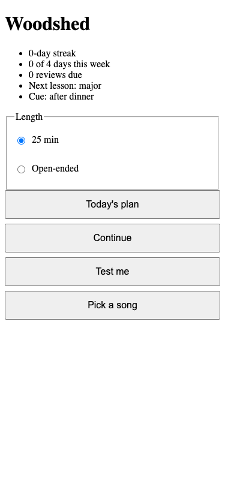
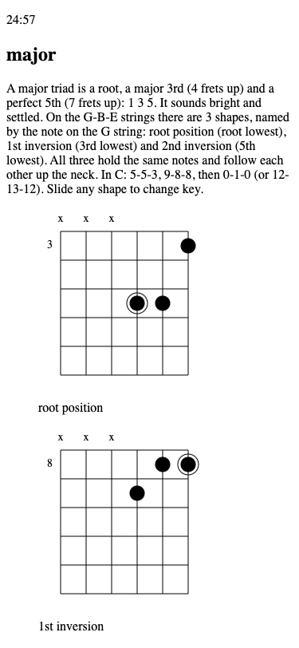
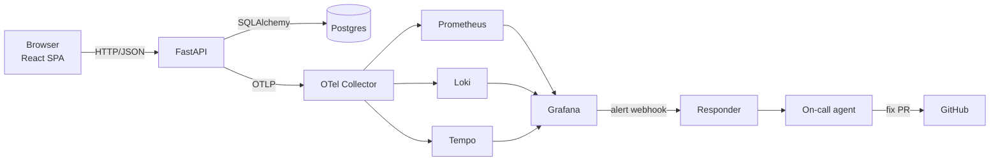
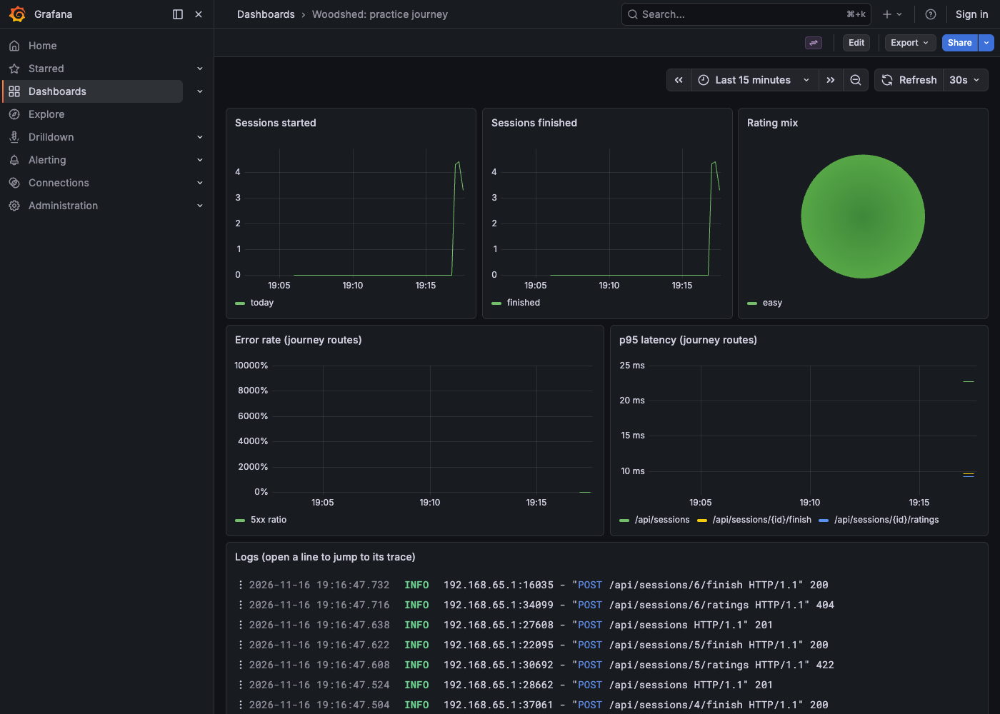
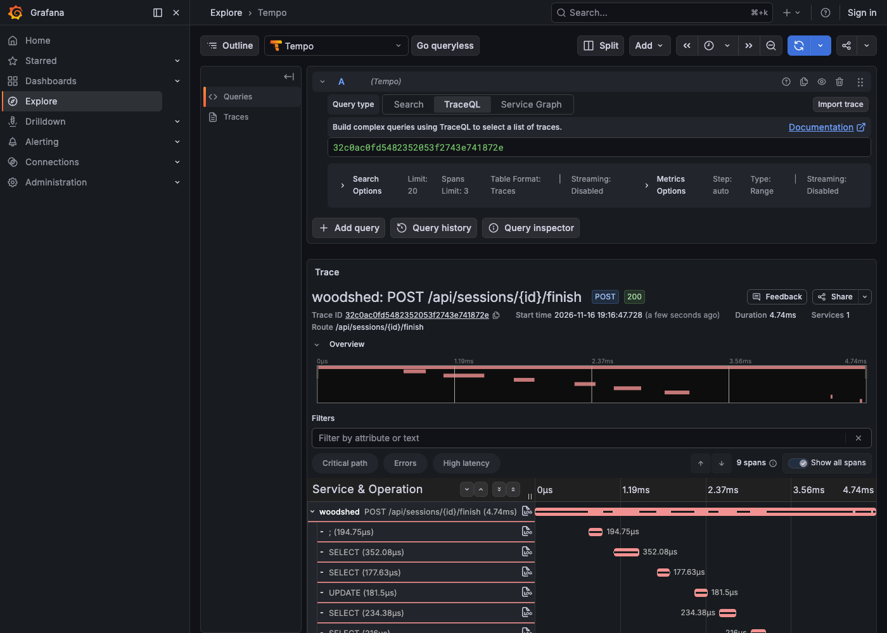

# Woodshed

A guitar practice planner. It tells experienced guitarists what to practice today and helps them keep at it.

- **Live (dev):** <https://woodshed-dev.onrender.com>, deployed on every merge to `main`
- **Live (prod):** <https://woodshed-prod.onrender.com>, deployed by hand with approval
- **Spec:** [`docs/plans.md`](docs/plans.md) · **Agent team:** [`docs/team.md`](docs/team.md) · **Backlog:** [Issues](https://github.com/salexyun/woodshed/issues)

## The problem

Players who have played for years often plateau. They don't know what to practice, so they replay the songs and shapes they already know. And they don't practice consistently, so what they learn fades before it is reinforced.

Woodshed removes the daily decision: it builds each session for you. And it makes regular practice easy to keep up, with short default sessions, a forgiving streak and reviews timed to memory. Each design decision rests on learning and habit research: the testing effect, spacing, interleaving, implementation intentions and repairable streaks ([`plans.md` §2](docs/plans.md#2-principles)).

## Features

v1 teaches the four triad qualities (major, minor, diminished, augmented) on the G-B-E strings: 12 movable shapes and 7 song passages.

- **Onboarding** (~3 minutes): a few questions and a playing and theory check that places what you already know, plus a habit cue ("After ___, I'll practice.") and a weekly goal.
- **Home:** streak, days practiced this week, reviews due, next lesson and your cue. Four actions: *Today's plan*, *Continue*, *Test me* and *Pick a song*.
- **Sessions:** review cards (recall, reveal, rate), lessons with fretboard diagrams, song passages and challenge cards. A 25-minute countdown or an open-ended timer that suggests stopping at 60 minutes.
- **Spaced repetition:** a Leitner scheduler (1 → 3 → 7 → 14 → 30 days). Reviews interleave qualities, and roots rotate through the cycle of fourths.
- **Consistency:** a streak that survives one missed day, and a weekly goal that resets every Monday.
- **Progress:** a map of the 12 shapes colored by box, session history and settings.

Mobile-first, because the phone sits on a music stand:

| Home | Session (lesson) |
| --- | --- |
|  |  |

## Architecture



- **Backend:** Python 3.12, FastAPI, Pydantic v2, SQLAlchemy 2.0, Alembic, Postgres 16. Domain logic (theory, scheduler, streak, planner) is pure functions in [`backend/woodshed/domain/`](backend/woodshed/domain); content is code in [`content.py`](backend/woodshed/content.py).
- **Frontend:** React, TypeScript, Vite and React Router, with no state library. API types are generated from FastAPI's OpenAPI schema (`make types`), and CI fails if they are stale.
- **One container per environment:** FastAPI serves the API under `/api` and the built SPA from `/`. Migrations run on start.
- **Hosting:** Render (`woodshed-dev`, `woodshed-prod`) runs images from GHCR, with Neon Postgres (one branch per environment).

## Run it

You need only Docker (with Compose).

```sh
git clone https://github.com/salexyun/woodshed.git
cd woodshed
make up    # or, without make: docker compose up --build --wait
```

This builds the image and starts Postgres, the app and the telemetry stack, runs migrations and waits until they are healthy. Open <http://localhost:8000> for the app and <http://localhost:3000> for Grafana. Data lives in the `pgdata` volume. Stop with `docker compose down`; add `-v` to delete the data too.

The app reads `DATABASE_URL` and, optionally, `PORT` (default 8000). It exports traces, metrics and logs over OTLP when `OTEL_EXPORTER_OTLP_ENDPOINT` is set (the standard `OTEL_*` variables apply); without it, it logs JSON lines to stderr only.

## Test it

```sh
docker compose up -d --wait db   # integration tests use a real Postgres
make test                        # pytest unit + integration, then Vitest
make lint                        # ruff check, ruff format --check, tsc --noEmit
```

| Suite | Where | Covers |
| --- | --- | --- |
| Unit | [`backend/tests/unit/`](backend/tests/unit) | Triad positions, Leitner transitions, root rotation, streak and week rules, plan building, placement, the responder |
| Integration | [`backend/tests/integration/`](backend/tests/integration) | The API end to end against Postgres: onboarding → home → session journey → progress, errors, migrations, telemetry |
| Frontend | [`frontend/src/`](frontend/src) | Components (`Fretboard`, `RatingButtons`, `ReviewCard`, `Timer`) and every screen against a mocked API |

Integration tests use their own `woodshed_test` database. Set `TEST_DATABASE_URL` if Postgres isn't on port 5432.

## CI/CD

| Workflow | Trigger | Does |
| --- | --- | --- |
| [`ci.yml`](.github/workflows/ci.yml) | Pull request to `main` | `make lint`, the OpenAPI types check, `make test` against a Postgres service |
| [`deploy.yml`](.github/workflows/deploy.yml) | Merge to `main` | Runs CI, builds the image tagged with the commit SHA, pushes it to GHCR, deploys to dev and waits until dev's `/healthz` reports that SHA |
| [`deploy-prod.yml`](.github/workflows/deploy-prod.yml) | Manual, with approval of the `prod` environment | Deploys an existing image by SHA (never rebuilds) and waits until prod's `/healthz` reports it |

**Deploy to prod:**

1. Pick the SHA to ship: usually dev's, the `version` at <https://woodshed-dev.onrender.com/healthz>.
2. Actions → **Deploy prod** → **Run workflow**, paste the full SHA and run.
3. Approve the `prod` deployment when the run asks for review.

**Rollback:** run **Deploy prod** again with the previous SHA, the one from the last good run in the **Deploy prod** runs list. This works only if no migration landed in between: the image runs `alembic upgrade head` on start, and an older image doesn't know a newer database revision, so it never comes up. That's why migrations are expand-then-contract ([#107](https://github.com/salexyun/woodshed/issues/107) tracks rolling back across one).

Example runs: [dev deploy](https://github.com/salexyun/woodshed/actions/runs/43894092246) · [prod deploy of `52981ce`](https://github.com/salexyun/woodshed/actions/runs/43898306118) · [rollback to `8fb554e`](https://github.com/salexyun/woodshed/actions/runs/43898903797)

## Observability

The app is instrumented with OpenTelemetry and exports to a Collector, which feeds Prometheus (metrics), Loki (logs) and Tempo (traces). Grafana shows all three. Everything is provisioned by `make up` from [`observability/`](observability).

- **Traces:** FastAPI and SQLAlchemy spans, plus spans for planning and scheduling.
- **Metrics:** HTTP request count and duration by route and status, `woodshed_sessions_started_total{action}`, `woodshed_sessions_finished_total` and `woodshed_ratings_total{rating}`.
- **Logs:** JSON lines that carry `trace_id` and `span_id`.
- **Privacy:** no request bodies, no free text (the player's cue) and no database error details reach telemetry. Tests in [`test_telemetry.py`](backend/tests/integration/test_telemetry.py) check this.

The **"Woodshed: practice journey"** dashboard ([JSON](observability/grafana/dashboards/practice-journey.json)) shows sessions started and finished, the rating mix, the error rate and p95 latency of the journey routes, and the app's logs. Open a log line to jump to its trace in Tempo.

| Dashboard | A log line's trace in Tempo |
| --- | --- |
|  |  |

The deployed services on Render have no `OTEL_EXPORTER_OTLP_ENDPOINT`, so they log JSON to stderr only. The full stack runs locally.

## Alerting

**"Practice sessions failing"** ([`alerting.yaml`](observability/grafana/alerting.yaml)) fires when more than 5% of `/api/sessions*` requests return 5xx over 5 minutes, with at least 3 requests. That means players can't start, rate or finish a session: the key journey is broken. It posts a webhook to the on-call responder at `RESPONDER_URL` (default `http://host.docker.internal:8090/alerts`).

## On-call agent

When the alert fires, [`incident-response/responder.py`](incident-response/responder.py) saves the alert and an evidence packet (Loki error logs and Tempo traces of failing `/api/sessions*` requests) to `incident-response/incidents/<id>/`. It then starts the [on-call agent](.claude/agents/on-call.md) headless (`claude -p` with [`task.md`](incident-response/task.md)). The agent queries Grafana through a read-only MCP server, reproduces the failure with a test, fixes it on `incident-<id>`, runs `make test`, writes a report and opens a PR. A resolved alert is recorded as `resolved.json` and starts nothing.

**Guardrails.** The run uses only the repo's settings (`--setting-sources project`), with auto-memory off. Its allowlist has no rule for merging, deploying, force-pushing or dispatching workflows, and deny rules block those commands. It pushes only its own branch and can't edit agent config, `CLAUDE.md`, `AGENTS.md`, `.mcp.json` or `.github/`. These rules match command text, and `make test` runs whatever code the agent writes, so they narrow the agent rather than sandbox it. The hard stops are on GitHub: branch protection on `main` and approval for prod deploys.

**Run it** from a checkout of the deployed branch (it must be on `origin`, since the PR targets it), with Python 3.12+, Claude Code and `gh` signed in:

```sh
export GRAFANA_URL=http://localhost:3000 GRAFANA_SERVICE_ACCOUNT_TOKEN=<viewer token>  # the agent's Grafana MCP
python3 incident-response/responder.py
```

It listens on `127.0.0.1:8090/alerts`, which works with Docker Desktop's `host.docker.internal`. On Linux, set `RESPONDER_HOST` to the Docker bridge address, e.g. `172.17.0.1`; the endpoint has no auth, so never bind it to all interfaces. It reads Loki from `LOKI_URL` (default `http://localhost:3100`) and Tempo from `TEMPO_URL` (default `http://localhost:3200`). The agent runs `make test`, so it also needs `TEST_DATABASE_URL` if Postgres isn't on 5432.

### Incident drill

A deliberate bug on the `drill-session-clock` branch made `get_now()` return a naive datetime, so every `POST /api/sessions` failed with a `TypeError` and returned 500. The alert fired 72 seconds after the first failure, and the responder started the agent. The agent:

- followed the failing traces to `api.start_session` → `planner.plan` → `scheduler.due`,
- wrote a regression test that runs the journey on the real clock,
- restored the aware UTC clock and ran `make test` (green),
- wrote the [incident report](incident-response/incidents/20261116-133510/report.md), with impact, timeline, PromQL/LogQL/TraceQL evidence and follow-ups,
- pushed the fix branch, recommending merge or a rollback to the parent SHA. It didn't merge or deploy.

Its `gh pr create` failed because the drill's base branch existed only locally, so the fix PR, [#100](https://github.com/salexyun/woodshed/pull/100), was opened from its branch afterwards. Hence the rule that the responder's branch must be on `origin`.

The drill's follow-ups are tracked in [#105](https://github.com/salexyun/woodshed/issues/105).

## How it was built: the agent team

Woodshed was built by five Claude Code subagents ([`.claude/agents/`](.claude/agents)) and one human, coordinated through GitHub Issues and PRs. [`docs/team.md`](docs/team.md) defines the roles, tools, flow and guardrails.

| Agent | Job |
| --- | --- |
| planner | Turns the spec into issues with testable acceptance criteria, ordered by dependency |
| tester | Writes failing tests from an issue's acceptance criteria |
| implementer | Writes the minimum code that passes them and opens the PR |
| reviewer | Checks the PR against the criteria, the spec and the code style; comments a verdict |
| on-call | Responds to alerts with a fix PR and an incident report |

[`AGENTS.md`](AGENTS.md) (also `CLAUDE.md`) is the entry point: a short guide that points to the spec and the team doc rather than repeating them. Agents read the issue and the spec sections it cites, not the whole spec. Independent issues ran in parallel waves, each agent in its own git worktree.

Every agent comments on the issue when it hands off, so the tracker shows who did what. [#13 (the sessions API)](https://github.com/salexyun/woodshed/issues/13) is a typical thread:

```
**tester:** 28 failing tests (31 total) in backend/tests/integration/test_sessions.py ...
**reviewer:** Changes requested on PR #52. All 6 acceptance criteria are met, but lesson steps have no challenge card (§5.4) ...
**reviewer:** Approve on re-review of PR #52 (43b574e). ... the follow-ups are tracked in #53 and #54.
```

Review findings that are out of scope become new issues. Work deferred past the first release carries the [`v2` label](https://github.com/salexyun/woodshed/issues?q=label%3Av2).

## Grading criteria

How this repo meets the [AI Dev Tools Zoomcamp project criteria](https://github.com/DataTalksClub/ai-dev-tools-zoomcamp/tree/main/project).

| # | Criterion | Where |
| --- | --- | --- |
| 1 | Problem description | [The problem](#the-problem); [`plans.md` §1–§2](docs/plans.md#1-problem) |
| 2 | Product specification | [`docs/plans.md`](docs/plans.md) (behavior, API, database, testing, operations). [Issues](https://github.com/salexyun/woodshed/issues?q=is%3Aissue) #1–#28 with acceptance criteria, cited spec sections and agent handoff comments (e.g. [#13](https://github.com/salexyun/woodshed/issues/13), [#26](https://github.com/salexyun/woodshed/issues/26)); PRs close them with `Closes #n` |
| 3 | Agent team specification | [`docs/team.md`](docs/team.md) (roles, tools, flow, handoffs, guardrails); [`.claude/agents/`](.claude/agents) |
| 4 | Context management | [`AGENTS.md`](AGENTS.md) points to the modular [`plans.md`](docs/plans.md) and [`team.md`](docs/team.md); issues cite spec sections (§) |
| 5 | Application | FastAPI + Postgres + React SPA, end to end: [Features](#features), [Architecture](#architecture); `make up` runs it |
| 6 | Testing | Unit and integration (pytest, real Postgres) plus frontend (Vitest) in [`backend/tests/`](backend/tests) and [`frontend/src/`](frontend/src); one command, `make test` |
| 7 | Containerization | [`Dockerfile`](Dockerfile) and [`compose.yaml`](compose.yaml): app, Postgres and the telemetry stack; one command, `make up` |
| 8 | Deployment | <https://woodshed-dev.onrender.com> and <https://woodshed-prod.onrender.com> on Render ([#23](https://github.com/salexyun/woodshed/issues/23), [#24](https://github.com/salexyun/woodshed/issues/24)) |
| 9 | CI/CD | [`ci.yml`](.github/workflows/ci.yml) on PRs; [`deploy.yml`](.github/workflows/deploy.yml) to dev on merge; [`deploy-prod.yml`](.github/workflows/deploy-prod.yml) manual with approval; [prod deploy](https://github.com/salexyun/woodshed/actions/runs/43898306118) and [rollback](https://github.com/salexyun/woodshed/actions/runs/43898903797) runs |
| 10 | Observability | OTel traces, metrics and JSON logs sharing `trace_id`, no customer data, in Grafana: [Observability](#observability), [`observability/`](observability), [#25](https://github.com/salexyun/woodshed/issues/25) |
| 11 | Alerting on user impact | "Practice sessions failing" on the session journey's 5xx ratio: [Alerting](#alerting), [`alerting.yaml`](observability/grafana/alerting.yaml), [#26](https://github.com/salexyun/woodshed/issues/26) |
| 12 | On-call agent | [`responder.py`](incident-response/responder.py), [`on-call.md`](.claude/agents/on-call.md); drill: [report](incident-response/incidents/20261116-133510/report.md) and fix PR [#100](https://github.com/salexyun/woodshed/pull/100) |
